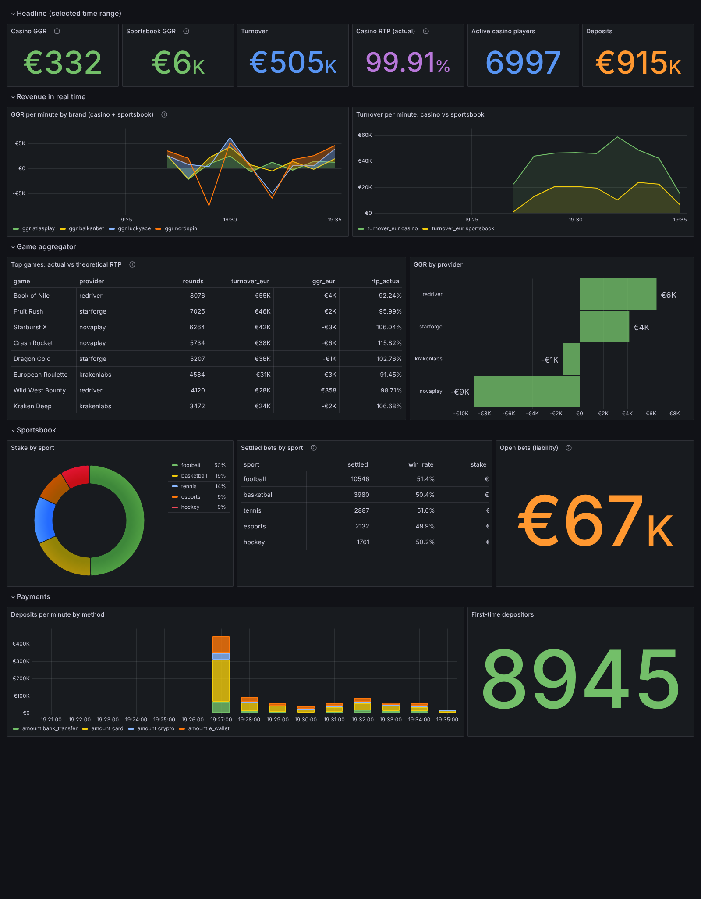
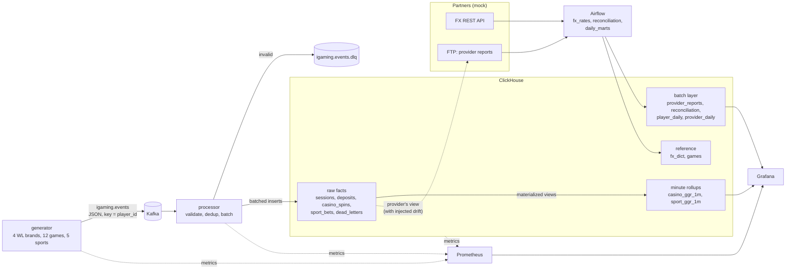
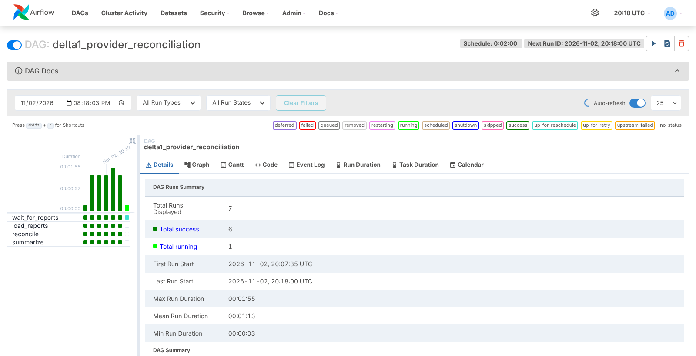
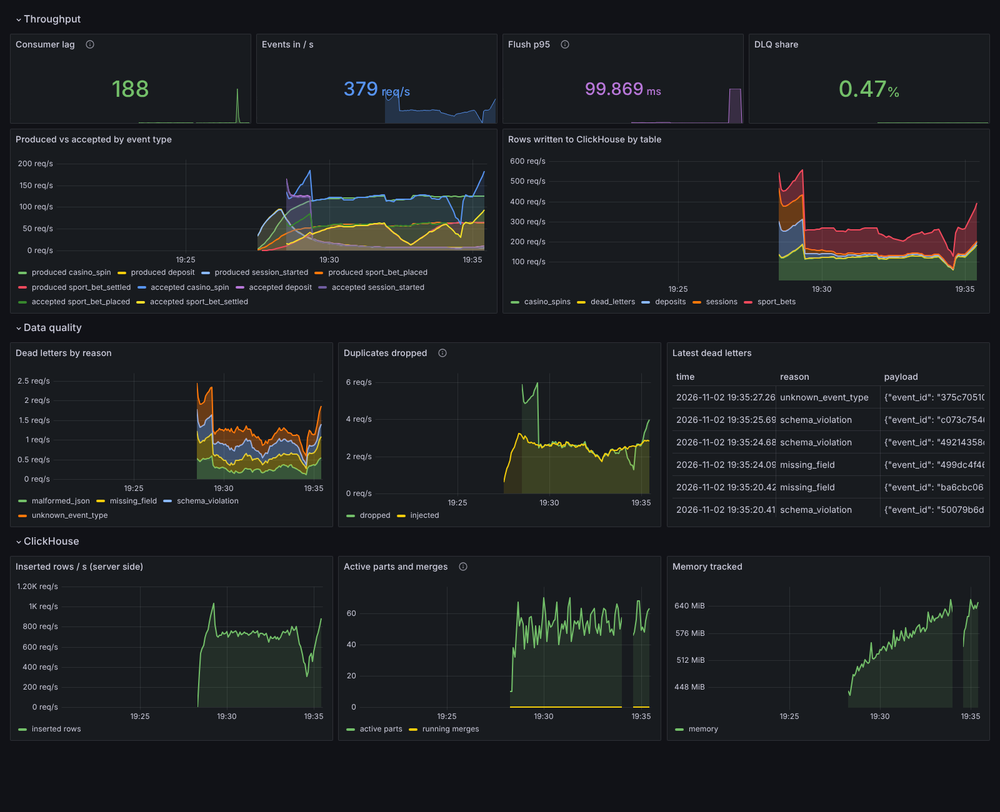
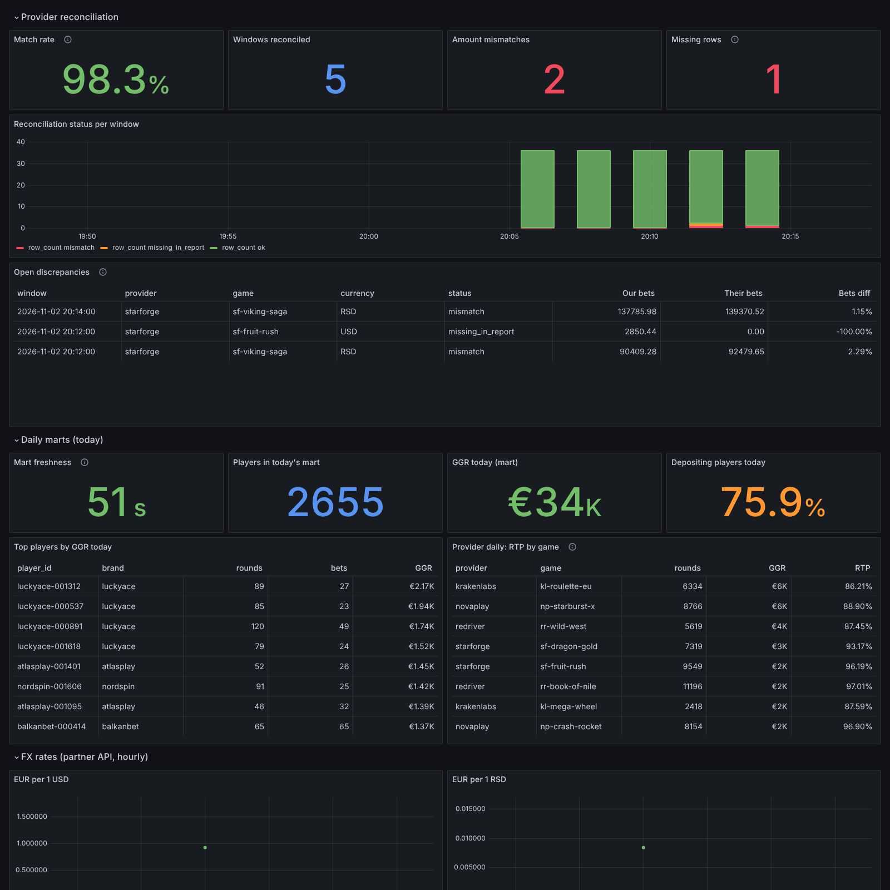

# Delta1 · real-time analytics for an iGaming platform

A small but production-shaped data platform for a white-label casino + sportsbook operator:
events flow from the platform through **Kafka** into a **Python stream processor**, land in
**ClickHouse**, are aggregated on the fly by **materialized views**, and are shown live in
**Grafana**. Next to the stream, **Airflow** pulls partner data over a **REST API** and
**FTP**, reconciles game-provider reports against the platform's own records, and builds
daily marts. Everything is observable with **Prometheus**.

Everything runs locally with one command and is covered by unit tests and an end-to-end CI job.



## What it shows

| Area | How it is done here |
| --- | --- |
| Streaming ingestion | Kafka (KRaft, 6 partitions, keyed by player), idempotent zstd producer |
| Stream processing | Typed event contract (pydantic), validation, dedup window, dead-letter topic, batching |
| Delivery semantics | At-least-once from Kafka, offsets committed only after ClickHouse accepts the batch |
| OLAP modelling | Day-partitioned `MergeTree` facts, `ReplacingMergeTree` for the bet lifecycle, `AggregatingMergeTree` minute rollups fed by materialized views, FX rates in a dictionary |
| Backpressure | A slow or down ClickHouse turns into consumer lag, not data loss (see [Resilience](#resilience)) |
| Observability | Prometheus metrics from every service and from ClickHouse itself, a pipeline-health dashboard |
| Product analytics | GGR, turnover, actual vs theoretical RTP per game, sportsbook hold, open-bet liability, deposits |
| Partner ingestion | Airflow pulls FX rates from a flaky REST API (retries with backoff, auth errors fail fast, validation and a circuit breaker on rate jumps) and provider reports from FTP (sensor in reschedule mode, atomic files) |
| Reconciliation | Per report window, a FULL JOIN of provider reports vs platform facts flags amount mismatches and rows missing on either side |
| Batch modelling | Daily player and provider marts rebuilt idempotently with write-audit-publish: staging, data-quality audits against raw facts, `REPLACE PARTITION` |
| Engineering hygiene | Dashboards as code, schema/code consistency tests, ruff, GitHub Actions with a dockerised e2e test |

## Architecture



**Generator** (`src/delta1/generator`) simulates players of four white-label brands in three
currencies. Each player has a persona (casual, regular, high roller) that sets stake size and
activity. Casino spins pay out according to each game's RTP and volatility, so actual RTP
converges to the catalog value over many rounds. Sportsbook bets are placed now and settled
5 to 90 seconds later with a 6% bookmaker margin. On purpose, about 1% of messages are sent
twice and 0.5% are broken (truncated JSON, negative amounts, unknown types, missing fields),
so the dedup and DLQ paths always have work to do.

**Processor** (`src/delta1/processor`) splits pure logic from I/O:

- `pipeline.py` turns raw bytes into table rows or dead letters. It has no Kafka or ClickHouse
  code and is unit-tested directly.
- `main.py` handles consuming, batching (by size or every 2 s), the DLQ producer, offset
  commits, rebalance handling (flush on revoke) and lag metrics.
- `sink.py` writes batches to ClickHouse and retries with exponential backoff.

**ClickHouse schema** (`clickhouse/init/01_schema.sql`):

- Facts are partitioned by day and sorted by the keys dashboards filter on, for example
  `casino_spins ORDER BY (brand, game_id, ts)`. `sql/examples.sql` has an `EXPLAIN indexes = 1`
  that shows the primary index pruning granules.
- A sportsbook bet is written twice, once when placed and once when settled.
  `ReplacingMergeTree(updated_ts)` keeps the latest version per `bet_id`.
- `casino_ggr_1m` and `sport_ggr_1m` are `AggregatingMergeTree` tables fed by materialized
  views. Dashboards read the minute aggregates, not the raw facts. `uniqState` keeps
  distinct-player counts mergeable across minutes.
- Amounts are stored in the original currency as `Decimal`. Conversion to EUR happens at query
  time through `dictGet` on an in-memory FX dictionary, so a rate update never rewrites history.

**Partners** (`src/delta1/partners`) is a mock of two third parties. The FX vendor serves
hourly rates over REST behind an API key and returns HTTP 503 on 20% of calls. The game
providers drop one CSV per provider for every report window on an FTP server. Their numbers
come from the platform's own spins, but about 15% of windows get one row drifted by 0.5% to 3%,
and about 5% lose a row. That is roughly what provider reports look like in practice.

**Airflow DAGs** (`airflow/dags`):

| DAG | Schedule | What it does |
| --- | --- | --- |
| `delta1_fx_rates` | hourly | fetch, then validate (all currencies present, positive, no move above 5% vs the current rate), then load history and latest, then `SYSTEM RELOAD DICTIONARY` |
| `delta1_provider_reconciliation` | every report window (10 min, `REPORT_WINDOW_MINUTES`) | an FTP sensor waits for all providers' files, then the reports are loaded (idempotent, `ReplacingMergeTree`), then reconciled against `casino_spins` for exactly the run's data interval. The run fails if more than 25% of rows disagree |
| `delta1_daily_marts` | every 15 min (`MARTS_INTERVAL_MINUTES`) | rebuilds the day of the run into a staging table with a snapshot cutoff, audits totals against the raw facts, then swaps the partition in. A failed audit leaves the published day untouched |

Connections come from `AIRFLOW_CONN_*` environment variables, and SQL lives in
`airflow/dags/sql/` with server-side parameter binding. The DAG-side CSV parser and the
partner's writer are tied together by a contract test.



## Run it

Requirements: Docker with Compose v2, about 4 GB RAM free.

```bash
make up        # build and start everything: stream, partners, Airflow, Prometheus, Grafana
make smoke     # end-to-end checks against the running stack (needs: pip install clickhouse-connect)
make logs      # follow generator and processor
make clean     # stop and delete data
```

| UI | URL |
| --- | --- |
| Grafana (anonymous viewer; admin/admin) | http://localhost:3000 |
| Airflow (admin/admin) | http://localhost:8080 |
| Prometheus | http://localhost:9090 |
| ClickHouse Play (delta1/delta1) | http://localhost:8123/play |

Tune the load in `.env` (see `.env.example`), for example `EVENTS_PER_SECOND=2000`, or
`REPORT_WINDOW_MINUTES=2` to see reconciliation runs sooner. `make smoke-batch` checks the
Airflow side once the first windows have been reconciled.

Coming from an earlier version? Schema files only run on an empty volume, so run `make clean` first.

### Develop

```bash
make dev && . .venv/bin/activate
make test lint
make dashboards   # rebuild grafana/dashboards/*.json from grafana/build_dashboards.py
```

## Dashboards

Both dashboards are generated by `grafana/build_dashboards.py` and provisioned from files.
CI fails if the committed JSON differs from what the builder produces.

- **Platform live overview**: GGR and turnover by brand and vertical, actual vs theoretical RTP
  per game with a colour-coded delta, provider GGR, sportsbook stake and hold by sport,
  open-bet liability, deposits by method, first-time depositors.
- **Partners and batch**: reconciliation match rate, mismatches and missing rows per window,
  the open discrepancies to raise with providers, mart freshness, top players and RTP by game
  from the daily marts, and FX history.
- **Pipeline health**: consumer lag, throughput, flush latency p95, DLQ share by reason,
  injected vs dropped duplicates, rows per table, ClickHouse inserted rows, parts and memory.





## Resilience

`make outage` stops ClickHouse for 30 seconds. The processor keeps retrying the same batch and
does not commit offsets, so Kafka holds the backlog. In a local run at 200 events/s, lag peaked
at about 8.7k messages and drained within seconds once ClickHouse came back. After recovery
the smoke test passes again: no duplicate spins, and MV turnover equals raw turnover. CI runs
the same scenario on every PR, then waits for the Airflow DAGs and checks that none of their
runs failed.

## Known trade-offs and next steps

- The dedup window lives in memory, so a processor crash followed by a replay can double-count
  in the materialized views. Next step: insert deduplication tokens derived from Kafka offsets,
  or keyed state in a stream processor such as Flink.
- Single-node Kafka and ClickHouse. A replicated cluster (ReplicatedMergeTree, Keeper,
  `Distributed` tables) and role-based access are the next milestone.
- Reconciliation compares casino rounds only. Sportsbook feed settlement checks would follow
  the same pattern.
- **Planned:** a load benchmark with query-plan analysis.

## Layout

```
src/delta1/            events contract, config, Kafka admin helpers
  generator/           catalog, behaviour simulator, producer service
  processor/           pure pipeline, dedup, ClickHouse sink, consumer service
  partners/            mock FX REST API, FTP server, provider report writer
airflow/               Airflow image, DAGs, their SQL
clickhouse/            schema + server config (Prometheus endpoint)
grafana/               dashboard builder, provisioned datasources and dashboards
prometheus/            scrape config
scripts/smoke_test.py  end-to-end invariants
sql/examples.sql       analytics queries and an EXPLAIN walkthrough
tests/                 unit tests (simulator statistics, pipeline, partners, schema/code
                       consistency) and DAG integrity tests
```
